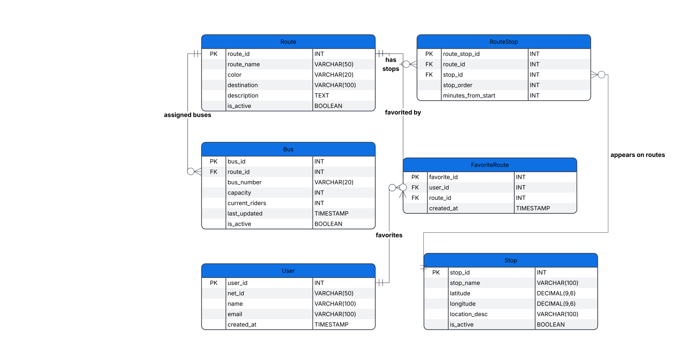
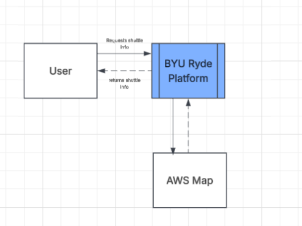
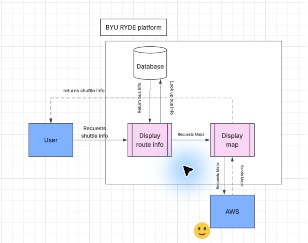

# BYU Ryde

BYU Ryde is a student-built shuttle-planning application for the Brigham Young University community.

## Project Overview

Finding the right campus shuttle can mean comparing routes, stops, and departure times across multiple sources. BYU Ryde brings those details together so riders can explore options and plan trips to and from campus.

## Features

- Browse seven shuttle routes, stops, and published departure schedules.
- Explore route maps and open walking directions in Google Maps.
- Plan trips to or from campus and view upcoming departures.
- Create an account, save favorite routes, and store a home location.
- Ask the AI trip assistant for help planning a route.
- View the protected OKR dashboard and maintain application records in the admin portal.

## Live Demo

- [BYU Ryde website](https://byu-ryde-team4-section4.onrender.com/)
- [Admin & OKR portal](https://byu-ryde-team4-section4.onrender.com/okr)

## Technologies

HTML, CSS, JavaScript, Node.js, Express, EJS, AWS Lambda, Amazon RDS for PostgreSQL, Amazon Location Service, Google Maps walking links, Google Gemini, and Render.

## Architecture

Render hosts the Node.js and Express application. Account and administrative requests travel through an IAM-signed Lambda invocation to a private PostgreSQL database on Amazon RDS. The browser does not connect directly to the database. Amazon Location provides mapping and place-search support; Google Gemini helps interpret trip questions, and the application validates the resulting fields before planning a trip.

Published route schedules and much of the route data are maintained in the application's JavaScript. PostgreSQL stores rider accounts, favorites, saved homes, calendar records, administrative sessions, and related data. Editing a route in the admin portal does not change the public timetable or map geometry.

## System Design & Architecture

These original course diagrams describe the project's intended design; some details differ from the final implementation described above.

### Entity Relationship Diagram



### Level 0 Data Flow Diagram



### Level 1 Data Flow Diagram



## Local Setup

Use Node.js 22 or later:

```powershell
npm ci
Copy-Item .env.example .env  # Only if .env does not already exist
npm start
```

Open `http://localhost:3000`. Configure the required values in `.env` privately. Local Express uses the configured Lambda backend for accounts and administrative data; without that configuration, public routes remain available but account APIs cannot connect. Set `GEMINI_API_KEY` to enable the AI assistant. Never commit credentials or `.env` files.

Run the automated tests with `npm test`. To build and verify the Lambda deployment package, install the dependencies and run `./package-lambda.ps1`; see [ADMIN_DEPLOYMENT.md](ADMIN_DEPLOYMENT.md) for deployment details.

## Admin Features

The password-protected `/okr` portal displays four OKR counters and provides maintenance for users, routes, favorite-route associations, saved home locations, and academic calendar records. The grading login uses `test123@byu.edu` and the shared administrator password, which is provided privately. Logout revokes the admin session. Published routes are protected from administrative renaming or deletion because the public application references them by name.

## Team Members

- Lex Bowman
- Calvin Hancock
- Emma Gillham
- Daniel Moreno

## Course

Brigham Young University, IS 401 — Fall 2026.
